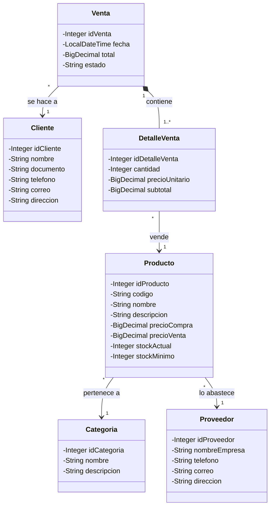
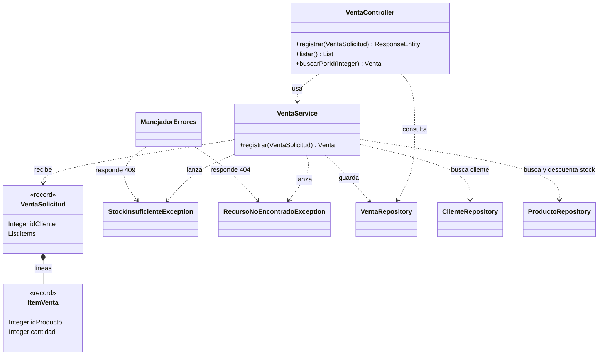

# Diagrama de clases - Modulo de inventario y ventas

## Modelo de dominio

Cada clase es una entidad JPA mapeada a una tabla de la base de datos `mydb`.

Una `Venta` contiene sus `DetalleVenta`: se guardan juntos (cascada) y no
existen por separado.

## Capa de ventas

Muestra como se registra una venta y donde nacen los errores.

`VentaService.registrar` es transaccional: si lanza una excepcion, se deshace
todo, incluido el descuento de stock.